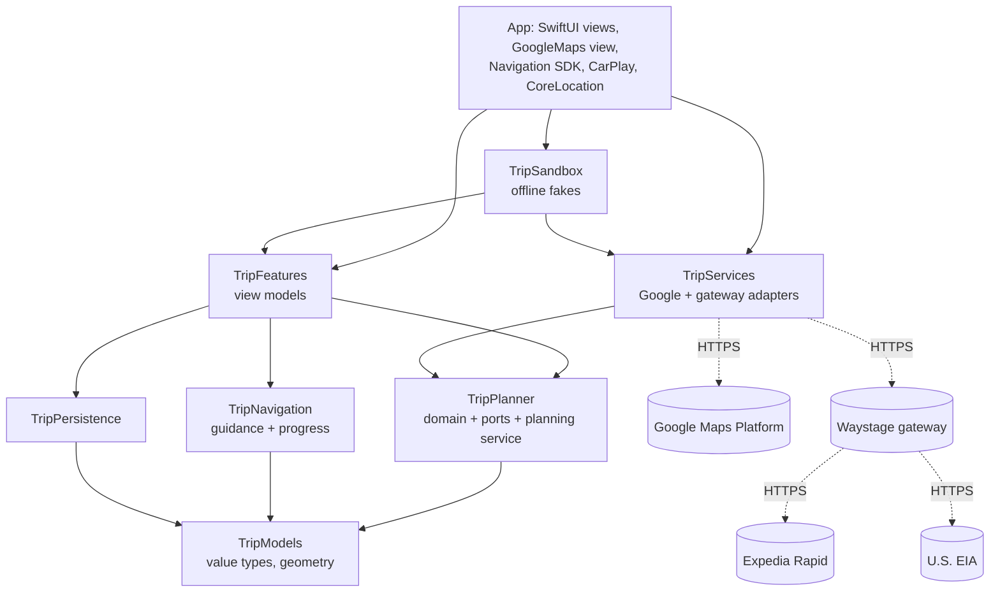

# Architecture

## Goals

1. **Correct and safe plans**: hard safety constraints are enforced by construction and
   re-checked by an independent validator.
2. **Testable without devices**: almost all logic lives in a platform-independent Swift package
   that builds and tests on Linux CI in seconds.
3. **Replaceable providers**: the planner talks to ports (protocols), so Google, Expedia or EIA
   can be swapped or faked without touching planning code.
4. **A thin, calm UI**: SwiftUI views only render view-model state.

## Layers and modules

| Module | Responsibility | Depends on |
|---|---|---|
| `TripModels` | Codable value types (`TripRequest`, `Itinerary`, `ActiveTrip`, …), `GeoMath`, `PolylineCodec`, `PolylineGeometry` (spatial index) | — |
| `TripPlanner` | `RouteProfile`, `CandidateBuilder`, `ItineraryOptimizer`, `FeasibilityPlanner`, `ScheduleValidator`, `ScheduleRetimer`, `LodgingWindowEstimator`, `TripPlanningService`, **ports** | Models |
| `TripServices` | `GoogleRoutesClient`, `GooglePlacesClient`, `WaystageGatewayClient`, `HTTPTransport` + retry | Models, Planner (ports) |
| `TripNavigation` | Trip state machine; `GuidanceEngine` (snapping, steps, prompts, off-route, arrival), used only by the offline simulation | Models |
| `TripPersistence` | `FileTripRepository` (versioned, atomic JSON), preferences | Models |
| `TripFeatures` | `@Observable` view models, formatters, deep links, platform ports (`LocationProviding`, `TurnByTurnGuidance`), `GoogleContentRetention` + `RetainingTripRepository` | Models, Planner, Navigation, Persistence |
| `TripSandbox` | Simulated Google backend (speaks the real wire formats), simulated GPS, `SimulatedGuidance`, fixtures | all |
| App | Views, `TripMapView` (Maps SDK + Navigation SDK), `GoogleNavigationEngine`, CarPlay scene, `CoreLocationProvider`, composition root (`AppEnvironment`) | all |

## Planning flow

1. `PlanTripViewModel` validates the form and calls `TripPlanning.plan(_:)`.
2. `TripPlanningService` requests routes (with alternatives, plus a toll-free route when tolls
   exist) from the **Routes API**, then routes through up to three highway hubs off those
   (`RouteAlternatives.viaHubs`: in the middle of the trip, at most 12 % out of the way, on both
   sides of the direct line; sent as `via` waypoints). `RouteAlternatives.select` keeps up to
   three corridors at most 10 % slower than the quickest, of which no more than 60 % runs within
   15 km of another; a toll-free near-copy stays with its corridor for cost-conscious plans.
3. For each route of each corridor (in parallel) it builds a `RouteProfile` (geometry + time along the route from step durations),
   splits it into ~2-hour sections and runs **Places "search along route"** for gas stations and
   rest areas, and for hotels only where a night is likely (`LodgingWindowEstimator`). A section
   that another route's sections already cover (same road, same kind of place) reuses their
   results instead of being searched again (`SharedSearches`), and each kind of search asks only
   for the fields it uses, which sets its price tier (`GooglePlacesClient.searchFieldMask`). Live fuel
   prices come from Places `fuelOptions`; hotel rates from the gateway (Expedia); regional fuel
   averages from the gateway (EIA).
4. `CandidateBuilder` projects places onto the route, computes detours, attaches prices (flagging
   estimates), merges duplicates, thins clusters and adds roadside pull-offs / lodging search
   areas so a feasible plan always exists.
5. `FeasibilityPlanner` runs the `ItineraryOptimizer` for each goal through the relaxation ladder
   (see [PLANNING_ALGORITHM.md](PLANNING_ALGORITHM.md)), per corridor. The result is a
   `PlanResult` of `RoutePlan`s, best first for the user's goal, each named after a place only it
   passes ("via Las Vegas") and labelled on the map where it differs most. The user picks one
   route and one plan; only that `Itinerary` is saved (`TripRepository`), never the alternatives.
6. Final directions for the chosen stops are fetched (batched by 25 waypoints), the schedule is
   re-timed with real leg durations and re-validated; if real detours broke a limit, it re-plans
   once with a safety margin.

## Drive flow

`DriveViewModel` decides where to go next and keeps the trip's progress; each leg goes to a
`TurnByTurnGuidance` engine: `setDestination` (the leg's preview) → `startGuidance` → events
(`progress`, `routeChanged`, `rerouting`, `arrived`) → `ActiveTrip.markArrived` → "Continue to
next stop" → next leg. Driving away from a stop starts the next leg automatically. Every state
change is persisted immediately; location-only updates at most every 30 s.

* App Store build: `GoogleNavigationEngine` (Google's Navigation SDK) routes from the phone,
  draws the route, car and turn header on the map, speaks, reroutes and detects arrival.
* Offline (demo, tests): `SimulatedGuidance` runs `GuidanceEngine` over the simulated backend
  and drives the simulated car.

The iPhone's drive screen and the CarPlay scene show the same `DriveViewModel`
(`AppEnvironment.drive`); CarPlay's maneuver card comes from the Navigation SDK's turn-by-turn
feed.

## Concurrency

* Package modules compile in **Swift 6 language mode** (complete data-race safety).
* View models and platform adapters are `@MainActor`; services are `Sendable` value types or
  actors; the planner is pure and synchronous inside an async service.
* Place searches run concurrently with a bounded `TaskGroup` (default 4 in flight).

## Error handling

* Service errors map to `ServiceError` (invalid request, unauthorized, rate limited, server,
  decoding, transport). Transient errors are retried with exponential backoff.
* Planning degrades gracefully: a failed place search yields generic breaks plus a warning;
  missing prices fall back to regional, then national estimates (flagged in the UI); missing
  final directions are fetched lazily during the drive.
* The UI shows actionable, plain-language messages; it never shows raw errors.

## Architecture decision records

### ADR-001 — Logic in a platform-independent Swift package
*Decision:* All domain, service and view-model code lives in `WaystageKit`; the app target is a
thin shell. *Why:* fast, deterministic tests on any machine (including Linux CI), enforced
boundaries, reuse for a future CarPlay or watchOS target.

### ADR-002 — Ports and adapters
*Decision:* `TripPlanner` defines `RoutingProvider`, `PlaceSearchProvider`, `LodgingRateProvider`,
`RegionalFuelPriceProvider` and `PlaceAutocompleteProvider`. *Why:* swap providers, fake them in
tests, and run the real adapters against a simulated backend.

### ADR-003 — Exact label-setting optimizer with a feasibility ladder
*Decision:* A resource-constrained shortest path over candidate stops instead of greedy
heuristics or a MILP solver. *Why:* exact for the modeled constraints, fast on-device (no
server), explainable relaxations. See the algorithm document.

### ADR-004 — Swift 6 for packages, Swift 5 mode + complete checking for the app shell
*Decision:* Packages use Swift 6 mode; the app target uses Swift 5 mode with
`SWIFT_STRICT_CONCURRENCY=complete`. *Why:* CoreLocation/AVFoundation delegate APIs still produce
isolation diagnostics on some SDKs; warnings keep the shell shippable while the logic is fully
checked. Migrate the shell to Swift 6 mode once it builds warning-free.

### ADR-005 — Google called directly; partner APIs behind a gateway
*Decision:* Google web services are called from the device with an API key restricted to the
iOS bundle ID and to the four APIs used. Expedia and EIA credentials live only in the gateway.
*Why:* Google supports iOS-restricted keys for web services (`X-Ios-Bundle-Identifier`); Expedia
secrets must never ship in a binary. The gateway can also cache and rate-limit.

### ADR-006 — Turn-by-turn with Google's Navigation SDK (supersedes "own guidance engine")
*Decision:* Turn-by-turn guidance comes from Google's Navigation SDK behind the
`TurnByTurnGuidance` port; Waystage keeps the trip and its stops. *Why:* Google's terms don't
allow re-creating navigation from the Routes API and the Maps SDK (3.2.3(d)(iv)) or speaking
Google content with a speech synthesizer (3.2.3(a)(iv)); the first version did both. The port
keeps the drive logic testable offline (`SimulatedGuidance`). See `docs/COMPLIANCE.md`.

### ADR-008 — Apple Maps fallback without a Google key
*Decision:* `RouteMap` renders with the Google Maps SDK when a key is configured (production) and
with MapKit for SwiftUI otherwise (demo mode, UI tests). *Why:* the Google SDK
draws no tiles without a valid key, which made previews look broken. Both renderers share the same
inputs (paths, colored stop dots, vehicle, camera) and the legend below the map.

### ADR-007 — XcodeGen
*Decision:* The Xcode project is generated from `project.yml`. *Why:* reviewable diffs, no merge
conflicts in `.pbxproj`.
