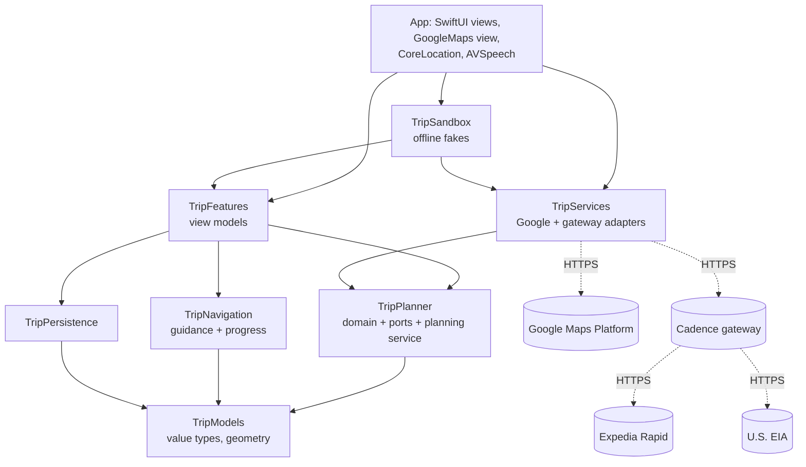

# Architecture

## Goals

1. **Correct and safe plans**: hard safety constraints are enforced by construction and
   re-checked by an independent validator.
2. **Testable without devices**: almost all logic lives in a platform-independent Swift package
   that builds and tests on Linux CI in seconds.
3. **Replaceable providers**: the planner talks to ports (protocols), so Google, Expedia or EIA
   can be swapped or faked without touching planning code.
4. **A thin, calm UI**: SwiftUI views only render view-model state.

## Layers and modules

| Module | Responsibility | Depends on |
|---|---|---|
| `TripModels` | Codable value types (`TripRequest`, `Itinerary`, `ActiveTrip`, …), `GeoMath`, `PolylineCodec`, `PolylineGeometry` (spatial index) | — |
| `TripPlanner` | `RouteProfile`, `CandidateBuilder`, `ItineraryOptimizer`, `FeasibilityPlanner`, `ScheduleValidator`, `ScheduleRetimer`, `LodgingWindowEstimator`, `TripPlanningService`, **ports** | Models |
| `TripServices` | `GoogleRoutesClient`, `GooglePlacesClient`, `CadenceGatewayClient`, `HTTPTransport` + retry | Models, Planner (ports) |
| `TripNavigation` | `GuidanceEngine` (snapping, steps, voice prompts, off-route, arrival), trip state machine | Models |
| `TripPersistence` | `FileTripRepository` (versioned, atomic JSON), preferences | Models |
| `TripFeatures` | `@Observable` view models, formatters, deep links, platform ports (`LocationProviding`, `SpeechAnnouncing`) | Models, Planner, Navigation, Persistence |
| `TripSandbox` | Simulated Google backend (speaks the real wire formats), simulated GPS, fixtures | all |
| App | Views, `TripMapView` (Google Maps SDK), `CoreLocationProvider`, `SpeechAnnouncer`, composition root (`AppEnvironment`) | all |

## Planning flow

1. `PlanTripViewModel` validates the form and calls `TripPlanning.plan(_:)`.
2. `TripPlanningService` requests routes (with alternatives, plus a toll-free route when tolls
   exist) from the **Routes API**.
3. For each route it builds a `RouteProfile` (geometry + time along the route from step durations),
   splits it into ~2-hour sections and runs **Places "search along route"** for gas stations and
   rest areas, and for hotels only where a night is likely (`LodgingWindowEstimator`). Live fuel
   prices come from Places `fuelOptions`; hotel rates from the gateway (Expedia); regional fuel
   averages from the gateway (EIA).
4. `CandidateBuilder` projects places onto the route, computes detours, attaches prices (flagging
   estimates), merges duplicates, thins clusters and adds roadside pull-offs / lodging search
   areas so a feasible plan always exists.
5. `FeasibilityPlanner` runs the `ItineraryOptimizer` for each goal through the relaxation ladder
   (see [PLANNING_ALGORITHM.md](PLANNING_ALGORITHM.md)) and picks the best route.
6. Final directions for the chosen stops are fetched (batched by 25 waypoints), the schedule is
   re-timed with real leg durations and re-validated; if real detours broke a limit, it re-plans
   once with a safety margin.

## Drive flow

`DriveViewModel` consumes `LocationSample`s from `LocationProviding`:
`GuidanceEngine.update` → banner + voice prompt → arrival → `ActiveTrip.markArrived` → the
"Continue to next stop" action → next leg. Off-route fixes (3 consecutive) trigger a reroute via
the Routes API. Driving away from a stop starts the next leg automatically. Every state change is
persisted immediately; location-only updates at most every 30 s.

## Concurrency

* Package modules compile in **Swift 6 language mode** (complete data-race safety).
* View models and platform adapters are `@MainActor`; services are `Sendable` value types or
  actors; the planner is pure and synchronous inside an async service.
* Place searches run concurrently with a bounded `TaskGroup` (default 4 in flight).

## Error handling

* Service errors map to `ServiceError` (invalid request, unauthorized, rate limited, server,
  decoding, transport). Transient errors are retried with exponential backoff.
* Planning degrades gracefully: a failed place search yields generic breaks plus a warning;
  missing prices fall back to regional, then national estimates (flagged in the UI); missing
  final directions are fetched lazily during the drive.
* The UI shows actionable, plain-language messages; it never shows raw errors.

## Architecture decision records

### ADR-001 — Logic in a platform-independent Swift package
*Decision:* All domain, service and view-model code lives in `CadenceKit`; the app target is a
thin shell. *Why:* fast, deterministic tests on any machine (including Linux CI), enforced
boundaries, reuse for a future CarPlay or watchOS target.

### ADR-002 — Ports and adapters
*Decision:* `TripPlanner` defines `RoutingProvider`, `PlaceSearchProvider`, `LodgingRateProvider`,
`RegionalFuelPriceProvider` and `PlaceAutocompleteProvider`. *Why:* swap providers, fake them in
tests, and run the real adapters against a simulated backend.

### ADR-003 — Exact label-setting optimizer with a feasibility ladder
*Decision:* A resource-constrained shortest path over candidate stops instead of greedy
heuristics or a MILP solver. *Why:* exact for the modeled constraints, fast on-device (no
server), explainable relaxations. See the algorithm document.

### ADR-004 — Swift 6 for packages, Swift 5 mode + complete checking for the app shell
*Decision:* Packages use Swift 6 mode; the app target uses Swift 5 mode with
`SWIFT_STRICT_CONCURRENCY=complete`. *Why:* CoreLocation/AVFoundation delegate APIs still produce
isolation diagnostics on some SDKs; warnings keep the shell shippable while the logic is fully
checked. Migrate the shell to Swift 6 mode once it builds warning-free.

### ADR-005 — Google called directly; partner APIs behind a gateway
*Decision:* Google web services are called from the device with an API key restricted to the
iOS bundle ID and to the three APIs used. Expedia and EIA credentials live only in the gateway.
*Why:* Google supports iOS-restricted keys for web services (`X-Ios-Bundle-Identifier`); Expedia
secrets must never ship in a binary. The gateway can also cache and rate-limit.

### ADR-006 — Own guidance engine on Routes API steps
*Decision:* Turn-by-turn guidance is implemented in `GuidanceEngine` using Routes API steps,
rendered on the Maps SDK, with a hand-off to the Google Maps app. *Why:* full control over stop
arrival detection and the "next stop" flow, testable logic, no extra SDK agreement. The Google
Navigation SDK can replace the engine later behind the same view model.

### ADR-008 — Apple Maps fallback without a Google key
*Decision:* `RouteMap` renders with the Google Maps SDK when a key is configured (production) and
with MapKit for SwiftUI otherwise (demo mode, UI tests, Appetize previews). *Why:* the Google SDK
draws no tiles without a valid key, which made previews look broken. Both renderers share the same
inputs (paths, colored stop dots, vehicle, camera) and the legend below the map.

### ADR-007 — XcodeGen
*Decision:* The Xcode project is generated from `project.yml`. *Why:* reviewable diffs, no merge
conflicts in `.pbxproj`.
